<!-- WOW DESIGN: navy grid "living identity" profile for Hafeed10 -->
<!-- Requires: assets/hero.svg in the same repo -->

<p align="center">
  
</p>

<!-- ============ STATS ROW ============ -->
<table align="center" width="100%">
  <tr>
    <td align="center" width="25%">
      <sub><code>REPOSITORIES</code></sub><br />
      
    </td>
    <td align="center" width="25%">
      <sub><code>FOLLOWERS</code></sub><br />
      
    </td>
    <td align="center" width="25%">
      <sub><code>FOLLOWING</code></sub><br />
      
    </td>
    <td align="center" width="25%">
      <sub><code>PUBLIC GISTS</code></sub><br />
      
    </td>
  </tr>
</table>

<p align="center">
  
  
</p>

---

## `// about`

```ts
const hafeed = {
  role: "Full-Stack Developer",
  building: "Django + React apps with REST APIs and clean, responsive UIs",
  exploring: ["Next.js", "Cloud deployments", "CI/CD"],
  interests: ["API design", "Authentication", "Database optimization", "Performance"],
  loves: "Pixel-perfect interfaces with Tailwind CSS + Vite",
  focus: "Clean, maintainable, scalable code",
};
```

---

## `// stack`

<p align="center">
  
  
  
  
  
  
  
  
  
  
  
  
  
  
  
  
  
  
</p>

---

## `// contributions`

<p align="center">
  
</p>

<p align="center">
  
</p>

<p align="center">
  
</p>

---

## `// projects`

| Project | What it does |
|:--|:--|
| **Django REST API Boilerplate** | JWT authentication, pagination, filtering, permissions, and production-ready API patterns |
| **React + Vite + Tailwind Starter** | Modern responsive frontend starter with reusable components and dark mode |
| **DRF + React Media Uploads** | File and image upload handling with previews, validation, and API integration |

> Pin your strongest repositories on your GitHub profile so visitors find your best work immediately.

---

## `// connect`

<p align="center">
  <a href="https://linkedin.com/in/your-id"></a>
  <a href="https://instagram.com/your-id"></a>
  <a href="https://t.me/your-id"></a>
  <a href="https://discordapp.com/users/your-id"></a>
</p>

<p align="center">
  <sub>⭐ If you like my work, consider starring one of my repositories!</sub>
</p>
